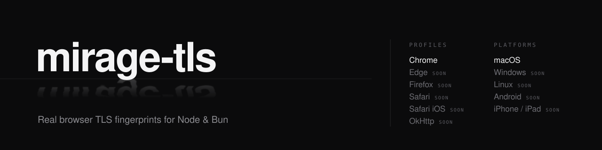

<p align="center"></p>

`mirage-tls` is a `fetch()` for Node.js and Bun that looks like a real browser on the wire: the TLS ClientHello (JA3 / JA4), the HTTP/2 connection (Akamai fingerprint: SETTINGS, WINDOW_UPDATE, priorities, pseudo-header order) and the request header order all match the browser you pick.

The engine is written in Rust on top of BoringSSL, the TLS library Chrome uses, with a few patches of our own (`vendor/boring-sys2/patches/mirage.patch`) for what recent Chrome sends: GREASE + ML-DSA in `signature_algorithms` and the `trust_anchors` extension.

```js
import { fetch, Session } from 'mirage-tls'

const res = await fetch('https://tls.peet.ws/api/all', { browser: 'chrome_157' })
console.log(res.httpVersion, res.status, await res.json())

// A session keeps cookies and reuses connections.
const s = new Session({ browser: 'firefox_windows', proxy: 'socks5h://127.0.0.1:1080' })
await s.fetch('https://example.com/login', { method: 'POST', json: { user: 'me' } })
```

`fetch` returns a standard `Response` (plus `httpVersion`) and accepts the usual `RequestInit`: `method`, `headers`, `body`, `redirect`, `signal`.

## Profiles

A profile name is `<family>[_<version>][_<platform>]`, e.g. `chrome`, `chrome_157_windows`, `safari_ios_26_ipad`.

| Family | Versions | Platforms | Status |
|---|---|---|---|
| `chrome` | 131+ (default 157) | macos, windows, linux, android | 157 macOS verified against a real capture |
| `edge` | 131+ (default 157) | windows, macos | unverified |
| `firefox` | 135+ (default 158) | macos, windows, linux, android | unverified |
| `safari` | 26 | macos | unverified |
| `safari_ios` | 26 | iphone, ipad, chrome | unverified |
| `okhttp` | 4, 5 | android | unverified |

The `sec-ch-ua` brand list is generated with Chromium's own GREASE algorithm, so any Chrome / Edge version number works. Profiles are plain TOML files in [`profiles/`](profiles); a custom one can be passed as JSON, optionally extending a built-in:

```js
new Session({ profile: { extends: 'chrome_157', http2: { window_update: 12517377 } } })
```

## Session options

`browser`, `profile`, `proxy` (`http://`, `socks5://`, `socks5h://`, with credentials), `timeout`, `connectTimeout`, `redirect` (`follow` | `manual`), `maxRedirects`, `cookies`, `headers`, `defaultHeaders`, `http1Only`, `insecure`, `ca`.

## Build

Requires Rust, CMake and Clang (BoringSSL is built from source).

```bash
cd crates/mirage-napi && npm install && npm run build
```

```bash
cargo run -p mirage-core --example fetch -- chrome_157 https://tls.peet.ws/api/all
```

## Not yet supported

Streaming response bodies (they are buffered), WebSocket, HTTP/3 / QUIC.
